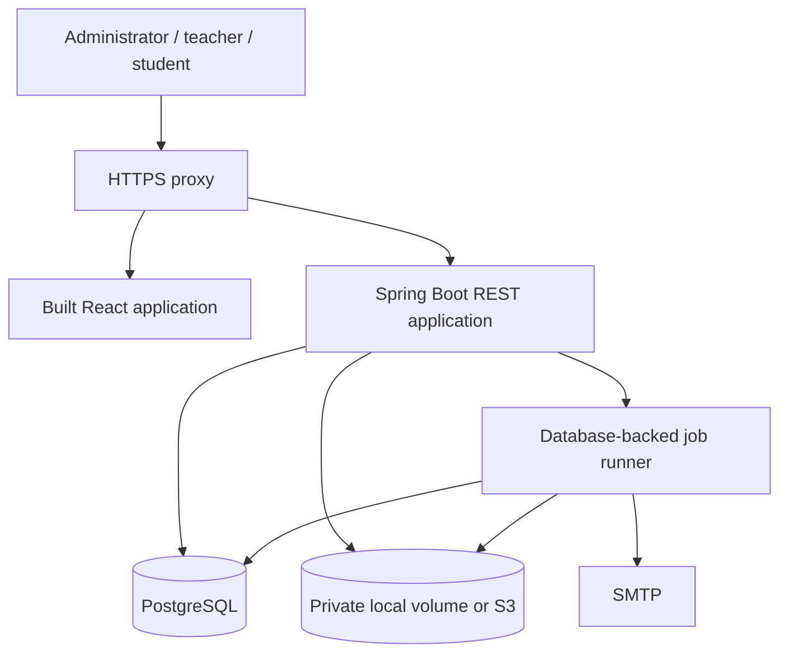

# Learning Portal Architecture Specification

**Date:** 18 October 2026 (Asia/Dhaka)  
**Status:** Written specification for user review; based on the approved in-chat architecture. New operational defaults below are proposed decisions, not previously approved details.  
**Companion:** [Implementation plan](../plans/2026-10-18-learning-portal.md)  
**Working product name:** Learning Portal. Final branding is independent of the implementation.

## 1. Purpose and success criteria

Build a self-hosted learning application for independent tutors and small schools. Teachers publish video, document, and text lessons; organize students into course classes; run objective and written exams; grade written answers; and monitor learning. Students study, track progress, take exams, receive published feedback, and obtain completion certificates.

The initial product is downloadable source code with reproducible installation. It does not require a central service operated by its author. Every installation serves one institution. An independent tutor is an institution with one teacher.

Success means a fresh installation can complete this journey: create teacher/student accounts → publish a course → create a class → enroll a student → study → take a mixed exam → grade → publish results → issue and verify a certificate. The same installation must preserve data through restart, upgrade, and backup restoration.

## 2. Scope and requirement identifiers

| ID | Required behavior |
| --- | --- |
| R01 | One institution per installation; branding and institution timezone |
| R02 | Administrator, teacher, student roles; assignment-scoped authorization |
| R03 | Secure sessions, account lifecycle, optional student email, invitations and assisted reset |
| R04 | Course authoring, immutable publication editions, preview and archiving |
| R05 | Classes reference a course edition; independent rosters, teachers and dates |
| R06 | Individual enrollment and validated CSV imports; suspension and withdrawal |
| R07 | Private video/document uploads, safe text content, local and S3 storage adapters |
| R08 | Explicit lesson completion and playback resume; student and teacher progress views |
| R09 | Single-choice, multiple-select, true/false and written questions |
| R10 | Versioned exams, class schedules, attempt limits and server deadlines |
| R11 | Durable answer autosave, safe concurrent writes and idempotent submission |
| R12 | Automatic objective scoring, manual written grading and separate publication |
| R13 | Completion from required lessons and required published passing assessments |
| R14 | Snapshot-backed PDF certificates, configurable verification and revocation |
| R15 | Durable notifications, jobs, retries and restart recovery |
| R16 | Authorized reports and CSV exports |
| R17 | Audit trail, upload safety, rate limiting and protected personal data |
| R18 | Docker and manual installation, migrations, backups, restore and upgrades |
| R19 | Responsive and keyboard-usable teacher/student workflows |
| R20 | Automated domain, authorization, concurrency and end-to-end verification |

Excluded from release 1: payment gateways, billing tables, public paid enrollment, multi-institution tenancy, parent accounts, school admissions/fees/timetables, native mobile apps, live classrooms, video transcoding, DRM, proctoring, AI grading, essay-file submissions, SCORM and instructor revenue sharing. Written answers are plain text. No scaffolding for excluded features.

## 3. Proposed engineering baseline

These constraints are copied into the plan and apply across tasks:

- One institution per installation; no tenant routing or `tenant_id` columns in release 1.
- No payments, subscriptions, billing, or payment-provider dependencies.
- Java 21; Spring Boot 4.1.1; Gradle Wrapper 9.x; PostgreSQL 17.
- React 19; TypeScript 5; Vite; Node.js 22.12 or newer within major 22; npm lockfile committed.
- One backend application; same-origin React and `/api/v1`; Spring Security sessions stored by Spring Session JDBC.
- Feature packages under `com.saasresearcher.learning`; module internals must not be imported across modules.
- UUID record identifiers; UTC `timestamptz` business timestamps; `Instant` and injected `Clock` in Java.
- Flyway owns schema changes; Hibernate schema mode is `validate`; no destructive automatic schema updates.
- PostgreSQL is authoritative for deadlines, answers, grades, completion and durable jobs; browser storage is never the source of truth.
- Content and exam publication editions are immutable; corrections publish a new edition.
- Existing classes retain their course edition and existing attempts retain their question snapshots.
- No correct answers, grading keys or unpublished grades in student API payloads.
- All protected records require server-side assignment or enrollment authorization.
- Exams include automatic objective scoring and teacher-graded written answers; no file-based exam answers.
- Certificates require all required lessons completed and all required exam assignments passed using published results.
- Docker Compose and manual Ubuntu VPS installation are required delivery paths.

Boot 4.1.1 and Java compatibility were checked against [official requirements](https://docs.spring.io/spring-boot/system-requirements.html) on 18 October 2026. Framework-managed dependencies use Boot's BOM. Task 1 must resolve compatible pinned patches for remaining dependencies and record them in build files and `docs/dependencies.md`; incompatibility must be resolved explicitly, not by silently changing this baseline. Use Apache PDFBox 3 for PDF output and ZXing for QR codes; bundle an appropriately licensed Unicode font with notices. Use ArchUnit for module-boundary checks, JUnit/AssertJ and Testcontainers for backend tests, and Vitest/Testing Library plus Playwright for frontend checks.

## 4. System context and deployment topology



The proxy serves frontend assets and routes `/api/v1` to the application. It terminates HTTPS, handles range-delivery proxying and bounded upload requests, and does not expose a public media directory. The application remains the authorization authority. Backend, database, and local files survive container replacement through persistent volumes.

The default deployment runs one application instance, PostgreSQL and the proxy. Job execution runs within the application using database leases. Multiple instances later share database sessions, jobs and S3 storage. No Redis, message broker, or search server is required.

Planning workload, not a measured capacity claim: 1,000 registered students, 100 active browser sessions, and 30 simultaneous exam takers. Validate non-media API p95 below 500 ms at that workload on a documented 4-vCPU/8-GiB reference machine with a local database; exclude file transfers, SMTP and PDF rendering from request latency. Record actual results and tune before claiming capacity. Media bandwidth is independently bounded by the operator's network/storage service. Initial operation targets: nightly backups (RPO at most 24 hours if healthy) and a tested restore runbook targeting four hours (RTO); these are acceptance goals, not hosting promises.

## 5. Module boundaries and contracts

Use package-by-feature. Each module exposes `api` interfaces/DTOs and hides implementation in `internal`. No cross-module entity associations or repository imports; exchange IDs and immutable DTOs. Database foreign keys remain permitted across modules. `common` contains only `Actor`, `PageResponse`, error types and time/ID infrastructure; it is not a business utility dumping ground.

| Module | Owned concerns | Public contract (Java) |
| --- | --- | --- |
| identity | accounts, roles, sessions, invites, resets | `IdentityAccess.requireActive(UUID userId): Actor` |
| institution | settings, branding and timezone | `InstitutionSettings.get(): InstitutionProfile` |
| audit | append-only business/security history | `AuditLog.record(AuditEntry entry): void` |
| notifications | durable job API, in-app notices, SMTP | `DurableJobs.enqueue(JobRequest request): UUID` |
| courses | drafts, published course editions, course teachers | `CourseCatalog.requirePublished(UUID versionId): PublishedCourse` |
| classrooms | classes, assignments, roster and access | `EnrollmentAccess.requireActive(UUID enrollmentId, Actor actor): EnrollmentView` |
| media | uploads, storage lifecycle and delivery | `MediaService.authorizeRead(UUID assetId, Actor actor): AuthorizedAsset` |
| learning | progress and resume | `LearningProgress.summary(UUID enrollmentId): LessonSummary` |
| assessments | exams, assignments, attempts, answers | `AssessmentResults.requiredResults(UUID enrollmentId): List<RequiredExamResult>` |
| grading | manual scores, grade publication and revisions | `GradePublication.publish(UUID attemptId, long expectedRevision, Actor actor): PublishedResult` |
| completion | eligibility and completion record | `CompletionService.reconcile(UUID enrollmentId): CompletionState` |
| certificates | snapshots, documents, verification and revocation | `CertificateService.issue(UUID completionId): UUID` |
| reporting | authorized read models/exports | `ReportingService.classProgress(UUID classId, Actor actor, PageQuery query): PageResponse<StudentProgressRow>` |

`Actor(UUID userId, Set<Role> roles)` always comes from the authenticated principal, never request JSON. `EnrollmentView(UUID id, UUID studentId, UUID classId, UUID courseVersionId, EnrollmentStatus status)` is the shared access result. `LessonSummary(int required, int completed, Instant lastActivityAt)` and `RequiredExamResult(UUID assignmentId, boolean publishedPass)` are small immutable read contracts.

`JobRequest(String type, UUID aggregateId, String deduplicationKey, String payloadJson, Instant availableAt)` is inserted into the caller's transaction. Job handlers are registered by type by the owning module; the runner never imports their internals. Event-driven follow-ups use these committed records, not fire-and-forget application listeners. Cross-module workflows have no synchronous cycle: learning/grading enqueue reconciliation; completion reads learning and assessment results and queues certificate work; certificates read completion and produce documents.

## 6. Roles, ownership and account lifecycle

| Action | Administrator | Assigned course teacher | Assigned class teacher | Enrolled student |
| --- | --- | --- | --- | --- |
| Institution/account management | Yes | No | No | Own profile only |
| Edit course draft/publish edition | Yes | Yes | Only if also course teacher | No |
| Manage class roster/schedule | Yes | No automatic class access | Yes | No |
| Read class progress / grade | Yes | No automatic class access | Yes | Own published records only |
| Read learning materials | Yes | Own course previews | Assigned class | Active enrollment and access window |
| Download certificate | Yes | No automatic access | Assigned class | Own certificate |
| Revoke certificate | Yes | No | Assigned class, reason required | No |

Teacher administration is limited to student accounts they create or teach: they cannot grant roles, reset administrator/teacher credentials, or browse unrelated students. An administrator cannot disable or demote the last active administrator. Removing an assignment invalidates access on the next request.

User lifecycle: `ACTIVE` or `DISABLED`; retain historical records on disable. A globally unique normalized username is required, normalized optional email is unique when present, and student email is optional. Teachers and administrators require email. Username is 3–64 ASCII letters/digits/dot/underscore/hyphen, case-insensitive; display names accept Unicode up to 150 characters. Passwords are 12–128 characters, hashed with a tuned adaptive Spring Security encoder. Reset/invitation tokens are cryptographically random, stored hashed, single-use and expire after 30 minutes / 72 hours respectively. Assisted reset issues a one-use temporary password, expires in 24 hours, revokes all sessions and requires password change before any other authenticated action. Log the reset action without logging credentials.

Initial installation needs no token or default password: the first visitor to the setup page creates the first administrator, so operators complete setup right after deploying. Setup is disabled once the first administrator exists. Session idle timeout is 60 minutes; active autosave requests keep a session alive. Password changes and disable actions revoke sessions. Authentication endpoints use configurable database-backed rate limiting: default 5 failed logins per normalized username plus IP per 15 minutes, with an additional IP-wide cap of 50. Return generic login/reset responses.

## 7. Content model and publishing

`courses` is stable identity/ownership. Editing occurs in a mutable `course_versions` row in `DRAFT`; sections and lessons belong to that row. Publishing validates nonempty title, at least one lesson, available assets, and completion policy; it seals that edition with a monotonically increasing edition number. Published content is immutable, including lesson text. Copy an edition to a new draft for corrections. Archiving removes it from creation/catalogue flows while existing classes retain access. Published records with references cannot be hard-deleted.

A lesson has a title, position within its section, sanitized rich text, optional primary video, optional resources, and `required` flag. Allowlisted HTML contains paragraphs, headings, lists, emphasis, links and safe tables; no scripts, arbitrary iframes or inline event handlers. Video embeds use a dedicated provider/ID field for YouTube or Vimeo rather than arbitrary HTML/URLs. No server fetch of user-provided URLs.

A class references a published course edition and freezes its completion policy when activated. The default self-paced class has no end date. Class states: `DRAFT → ACTIVE → ARCHIVED`. Dates govern access availability; reaching an end date does not delete grades. At activation, required course exam versions are materialized into class exam assignments. Required assignments cannot be deleted, swapped, or added after the first enrollment; new optional practice assessments remain allowed. Dates may be adjusted for unstarted attempts, with audit history; an existing attempt retains its original effective deadline.

No migration of active enrollment to another course edition in release 1. No exceptional teacher completion overrides. A tutor's create-class shortcut pre-fills a default class but invokes the same validation and permissions.

## 8. Roster and enrollment

`enrollments` links student to class with `ACTIVE`, `SUSPENDED`, or `WITHDRAWN`. Completion is a separate record. Access requires active user, active enrollment, active class and an open class access window. Student historical results/certificates remain readable after class archiving or withdrawal; media and new attempts do not. Teachers retain authorized historical reports. Suspension denies further answer writes; unfinished attempts finalize from acknowledged answers at their deadline.

CSV columns: `username,display_name,email`; UTF-8, optional BOM, maximum 1 MiB and 1,000 rows. Preview validates every row and duplicate normalized usernames, existing-account ambiguity, and permissions. No email/password fields in returned error reports beyond supplied nonsecret identity fields. Commit revalidates transactionally and is all-or-nothing; existing matching students may be enrolled, existing staff identities require administrator handling. Unique `(class_id,student_id)` prevents duplicate enrollment. A teacher cannot use import to overwrite a user's name, email or role. New accounts use invitation delivery when email exists, otherwise one-time downloadable temporary-credential delivery to the authorized creator; credentials never appear in logs or later exports.

## 9. Media storage and delivery

`media_assets` owns generated storage keys, original safe display filename, MIME, size, SHA-256, uploader, asset purpose, lifecycle and timestamps. Attachments link to courses/lessons by ID; no public filesystem paths. States: `UPLOADING → VALIDATING → AVAILABLE` or `REJECTED`; abandoned uploads expire after 24 hours. Referenced published assets cannot be deleted; orphan cleanup waits seven days. For edition copying, immutable available assets can be referenced again.

Defaults: video maximum 500 MiB (MP4, H.264/AAC-compatible), document maximum 25 MiB (PDF/TXT), branding image maximum 5 MiB (PNG/JPEG, decoded and re-encoded); quotas configurable per installation. No Office/ZIP/HTML/SVG uploads in release 1. Validate declared and detected type, file signature, safe size, and video metadata using `ffprobe` without transcoding. Validation is not a malware-free guarantee. Serve PDFs in a sandboxed viewer context with restrictive CSP; text as escaped text and downloads as attachment with `nosniff`. No HTML from uploaded filenames or file bodies is executed.

`AssetStore` exposes `put`, `stat`, `openRange`, and `delete`; `LocalAssetStore` streams to a staging file then atomically renames. `S3AssetStore` uses private keys and bounded server-mediated multipart streaming; complete/abort multipart uploads reliably. Application memory must not scale with video size. Downloads check parent lesson enrollment or teacher preview assignment on each authorization. Local delivery supports HTTP Range (206/416). S3 delivery issues 60-second presigned GET URLs after authorization; a previously issued URL can survive withdrawal until it expires. Prevent shared proxy caching; use `Cache-Control: private, no-store`. Do not claim DRM. External provider embeds cannot become private through application authorization.

## 10. Learning and completion

Unique `(enrollment_id,lesson_id)` progress stores `completed_at`, greatest acknowledged resume position, last activity and revision. Completion is an explicit action for all lesson types; a resume timestamp is not evidence of mastery. A student can clear a lesson's completion before course completion; after completion records are created, no student undo is allowed. Required lesson percentage = `completed_required / total_required × 100`; when zero lessons are required, lesson requirements are satisfied but UI shows “No required lessons,” not a misleading 100% study claim.

Resume writes carry expected revision and never regress due to an older save. Student may intentionally seek backward for playback, but the canonical saved resume is monotonic in release 1; this behavior is documented. Progress views expose separate lesson percentage, exam requirements and completion. Activity denotes acknowledged study/assessment actions, not proof of attention. Instructor inactivity flag defaults to seven days since activity, or enrollment if never active, and is configurable from 1–90 days.

Completion reconciliation reads the class's frozen requirements and highest published score per required assignment. Pending grades and drafts cannot satisfy a requirement. The same transaction locks the enrollment, records a unique completion, and enqueues certificate issue. A published grade correction that removes a required pass changes completion to `INVALIDATED` and revokes the certificate with a system reason. If a later published result restores eligibility, set completion `ACHIEVED`; do not silently un-revoke a certificate. Administrator explicitly reinstates the same certificate, with audit history and a regenerated PDF from its original snapshot. This preserves one certificate per completion.

## 11. Assessments and attempts

An exam belongs to a course; each immutable `exam_version` contains question text, type, position, positive decimal points, options, private grading key and optional explanation. Supported types: `SINGLE_CHOICE`, `MULTIPLE_SELECT`, `TRUE_FALSE`, `WRITTEN`. Multiple-select uses exact-set scoring with no partial/negative marks. Written response maximum is 20,000 characters; question maximum is 10,000; 1–100 questions per exam. Use decimal arithmetic, points scale 2; pass compares exact earned/max percentage before rounding display values.

Class exam assignments specify version, required/optional, opens/closes, optional duration, maximum attempts (default 1, 1–10), result policy and feedback policy. Defaults: objective-only `AUTO_PUBLISH`; mixed `TEACHER_PUBLISH`. Override to teacher publication is allowed; mixed auto-publication is not. `AFTER_CLOSE` feedback is allowed only with a closing time. Feedback defaults to score/comments without answer keys; explanations/keys are released only after closing and when the student has no active attempt. Practice exams can explicitly choose feedback after submission; warn teachers that immediate keys plus retries reveals answers.

Start attempt under an enrollment-level lock. Check user/enrollment/class access, schedule and attempt count; return an existing in-progress attempt on repeated start. Default duration is 60 minutes; configured durations are 1–240 minutes, or untimed with a finite closing time. Effective deadline = minimum of start plus duration and assignment close, ignoring absent values. At least one deadline bound is mandatory. Shuffle once using secure randomness; store question/option order and full private snapshots. All times use server Clock, translated only for presentation.

Each answer save locks the attempt first, checks `IN_PROGRESS` and `now < expires_at`, then checks expected answer revision. Insert with expected revision 0; increment on success; stale writes return 409 with current student-safe answer. Student UI serializes saves per question and retries only after reconciliation, never blindly replaces a newer answer. Submit flushes acknowledged saves before request; backend locks the same attempt and transitions once, scoring saved answers. At `now >= expires_at`, answer changes are rejected and finalization uses saved answers. Deadline finalization does not depend solely on a scheduler: reads/writes/submit also reconcile expired state. A scheduled job sweeps every 15 seconds. Repeated submit returns the existing finalized outcome. Unanswered questions receive zero; written items require explicit teacher grading, including intentional zero.

Attempt state and publication are separate: `IN_PROGRESS → SUBMITTED → AWAITING_GRADING or GRADED`; `GRADED` can have a published grade revision. Objective-only auto policy publishes once scoring completes. A disabled student cannot write answers, but finalization preserves previous answers. No proctoring, cheating detection or offline exams are promised.

## 12. Grades and publication

Teachers grade only assigned classes (or administrator access). Manual grade changes use expected revision, 0 ≤ points ≤ question maximum, and optional feedback up to 5,000 characters. Draft grades are private. Every written item must be explicitly graded before finalization. Finalization sums all grades; publication creates an immutable result revision containing per-question scores and permitted feedback. Student reads published revision, not the mutable draft; pending grades appear as pending, never final zero. Pending/graded/unpublished totals stay out of class student leaderboards and student exports.

Regrading clones the latest grade into a new draft and requires a reason up to 1,000 characters. Students retain the previous published result until the replacement is atomically published. Publication enqueues completion reconciliation in its own transaction and audits old/new published totals. Teacher feedback sanitization is plain text. Bulk publication is not part of release 1; sequential per-attempt publication can be added later.

## 13. Certificates

Snapshot institution name/logo/signature, student display name, course title/edition, completion date, template revision and verification policy at issuance. Certificate states: `PENDING_RENDER`, `ISSUED`, `RENDER_FAILED`, `REVOKED`; retain render failure detail privately and allow retry. A revocation arriving before rendering wins; renderer checks current status under lock before publishing the file. One certificate per completion; retries reuse ID and snapshot.

Generate PDF server-side with PDFBox, embedded Unicode font and QR verification URL only when verification is enabled. Detect unsupported glyphs and return actionable rendering failure rather than replacing the student's name silently. Verification is disabled by default for school privacy; administrator may enable it. Use at least 128 bits of random token entropy, store token hash for lookup, and keep the URL token available only inside the private certificate artifact/snapshot. Public response when enabled contains institution, course, issue date and validity only; student identity appears only if separately enabled. Disabled verification returns 404. Revoked codes return minimal revoked status. Certificate download requires student owner or authorized staff and remains possible after enrollment withdrawal. Revocation/reinstatement requires reason and audit event.

## 14. Persistence layout and constraints

All domain IDs are UUID; foreign keys are indexed on common joins. `version` columns implement optimistic locking for editable aggregates. SQL migrations are append-only after release. No cascade delete of published learning history. Independent module repositories use IDs, not lazy cross-module JPA entity graphs.

| Group | Tables and important keys |
| --- | --- |
| Identity | `users` (unique normalized username/email), `user_roles`, `invitations`, `password_reset_tokens`, `auth_rate_limits`, Spring Session tables |
| Institution | singleton `institution_settings` |
| Courses | `courses`, `course_teachers` (unique pair), `course_versions` (unique course/edition), `sections`, `lessons`, `lesson_resources`, `course_required_exams` |
| Classes | `classes`, `class_teachers`, `enrollments` (unique class/student) |
| Media | `media_assets` (unique storage key) |
| Learning | `lesson_progress` (unique enrollment/lesson) |
| Exams | `exams`, `exam_versions`, `exam_questions`, `question_options`, `exam_assignments` |
| Attempts | `exam_attempts` (unique enrollment/assignment/attempt number, partial unique active attempt), `attempt_questions`, `attempt_answers` (unique attempt/question), `answer_grades`, `grade_revisions`, `published_question_grades` |
| Completion | `course_completions` (unique enrollment), `certificates` (unique completion, unique verification hash) |
| Operations | `background_jobs` (unique deduplication key), `notifications`, `audit_events` |

Indexes: enrollments by class/status; progress by enrollment; attempts by assignment/student and status/expires_at; grading queue by class/status; jobs by status/available_at; notifications by recipient/read_at; audit by aggregate/time. Add SQL CHECK constraints for bounded points and valid state fields; cross-table eligibility belongs in transactional services.

## 15. HTTP and UI contract

REST base `/api/v1`; JSON UUIDs and ISO-8601 UTC timestamps. Page response `{items,page,size,total}`; page starts at 0, default size 25, maximum 100. Use RFC 9457-style problem responses `{type,title,status,detail,code,fieldErrors,traceId}`. Never return stack traces. Codes distinguish `ANSWER_REVISION_CONFLICT`, `ATTEMPT_EXPIRED`, `ACCESS_DENIED`, `GRADING_INCOMPLETE`, and validation errors. Forbidden/unrelated resource reads use 404 to avoid exposing existence; authenticated global-role denial can return 403. Mutations use transactions and explicit command DTOs, never bind request JSON to persistence entities.

| Route | Main action and authorization |
| --- | --- |
| `GET /auth/csrf`, `POST /auth/login`, `POST /auth/logout`, `GET /auth/me` | Session lifecycle; login/logout CSRF protected |
| `POST /setup`, `/auth/invitations/accept`, `/auth/password-reset/request`, `/auth/password-reset/confirm` | Token-bound account setup and reset |
| `/users`, `/institution` | Scoped account management and administrator settings |
| `/courses`, `/courses/{id}/draft`, `/courses/{id}/publish`, `/courses/{id}/preview` | Course teacher or administrator |
| `/classes`, `/classes/{id}/teachers`, `/classes/{id}/enrollments` | Assigned class teacher or administrator |
| `POST /classes/{id}/imports/preview`, `POST /classes/{id}/imports/commit` | Validate and commit roster import |
| `POST /media`, `GET /media/{id}/content` | Authorized upload and private range download |
| `GET /me/learning`, `GET /me/enrollments/{id}` | Own dashboard and course player |
| `PUT /enrollments/{id}/lessons/{lessonId}/progress` | Own active enrollment; expected revision |
| `/exams`, `/exam-assignments` | Assigned author/scheduler; no keys in student views |
| `POST /exam-assignments/{id}/attempts`, `GET /attempts/{id}` | Start/resume own attempt |
| `PUT /attempts/{id}/answers/{questionId}`, `POST /attempts/{id}/submit` | Save and finalize own attempt |
| `GET /grading`, `PUT /grading/attempts/{id}/answers/{questionId}` | Teacher queue/manual score |
| `POST /grading/attempts/{id}/finalize`, `/publish`, `/regrade` | Grade lifecycle with revision/reason |
| `GET /me/results`, `GET /me/certificates`, `GET /certificates/{id}/download` | Own released records; scoped staff download |
| `POST /certificates/{id}/revoke`, `/reinstate` | Authorized staff; reason; reinstatement administrator-only |
| `GET /public/certificates/{token}` | Configurable minimal public verification |
| `/reports/classes/{id}/progress`, `/reports/classes/{id}/scores`, `/reports/classes/{id}/export` | Scoped staff reports; student never calls staff routes |
| `GET /notifications`, `PUT /notifications/{id}/read` | Own in-app notifications |

OpenAPI is checked into `docs/api/openapi.yaml` during implementation and kept synchronized in contract tests. `AnswerSaveCommand(long expectedRevision, Set<UUID> selectedOptionIds, String writtenText)` uses exactly one answer representation appropriate to the snapshot type. `AnswerSaved(UUID questionId,long revision,Instant savedAt)` acknowledges persistence, not just receipt. `AttemptView` includes server time/deadline, state, student-safe questions, own saved answers, and revision; it excludes keys, grading rubric and unpublished results.

Frontend routes: `/login`, `/change-password`, `/admin/settings`, `/admin/users`, `/teacher/courses`, `/teacher/courses/:id/edit`, `/teacher/classes`, `/teacher/classes/:id`, `/teacher/grading`, `/teacher/grading/:attemptId`, `/student`, `/student/enrollments/:id`, `/student/attempts/:id`, `/student/results`, `/student/certificates`, `/verify/:token`. Role switches use a shared account menu. Every list supports loading, empty, error and pagination states. Student exams provide saved/saving/error status, accessible timer announcements only at useful thresholds, and a submit confirmation showing unsaved answers. Do not persist exam answers or keys in localStorage. A disconnected tab may hold unacknowledged answers in memory and clearly warn about navigation loss.

## 16. Security, jobs and reporting

Session cookie: Secure in production, HttpOnly, SameSite=Lax. CSRF token is separate and readable by the frontend; rotate/refresh on authentication changes. Keep Spring's SPA CSRF configuration; do not disable CSRF to make React work. [Spring Security CSRF reference](https://docs.spring.io/spring-security/reference/servlet/exploits/csrf.html). CSP allowlists configured video providers; no wildcard frame/script domains. No secrets in code, URLs, telemetry or error reports. Record audit actor/action/aggregate/time/outcome and safe change metadata; omit raw exam answers and credentials from logs.

Jobs have `PENDING`, `RUNNING`, `SUCCEEDED`, `FAILED`, attempts, available_at, lease_until and deduplication key. Claim with `FOR UPDATE SKIP LOCKED`, 60-second leases renewed every 20 seconds for long jobs; reclaim expired leases. Retry after 1 min, 5 min, 30 min, 2 h; the fifth failed execution is terminal and visible to administrator. Every handler tolerates at-least-once execution. Email may duplicate around an SMTP acknowledgement crash; record that limitation rather than claiming exactly-once delivery. Unique in-app notifications prevent duplicate visible notices. An SMTP failure never undoes enrollment or a published grade. [PostgreSQL locking reference](https://www.postgresql.org/docs/current/explicit-locking.html).

Reporting reads authorized projections, not a separate analytics database. Include class completion matrix, inactivity, required exams, best published score, pending grading and downloadable CSV. Protect spreadsheet exports from formula injection by prefixing cells beginning with `=`, `+`, `-`, `@`, tab or CR as text. Jobs generate large exports into private assets and notify only the requesting staff member. Grade reports identify source/published revision and export UTC plus institution timezone context.

## 17. Delivery, operations and testing

Repository structure:

```text
backend/build.gradle.kts, settings.gradle.kts, gradle.lockfile, gradlew, gradle/
backend/src/main/java/com/saasresearcher/learning/{module}/{api,internal}/
backend/src/main/resources/{application.yml,db/migration/}
backend/src/test/java/com/saasresearcher/learning/
frontend/{package.json,package-lock.json,src/{app,features,shared},e2e}/
deploy/{compose.yml,Caddyfile,backend.Dockerfile,frontend.Dockerfile}
scripts/{backup.sh,restore.sh,verify-backup.sh}
docs/{api,runbooks,dependencies.md,third-party-notices.md,superpowers/}
```

Configuration covers database, canonical public origin, session security, storage mode, local path or S3 credentials, upload quotas, SMTP, inactivity days and certificate verification. Fail fast on missing production secrets; SMTP absence is allowed with an admin-visible warning and assisted-account setup. Test/dev email capture must never masquerade as delivered mail. Health exposes liveness and protected/internal readiness; readiness checks database and selected storage. Structured logs carry trace IDs but no student answer bodies.

Backups: maintenance window disables mutations and runs, drains or pauses jobs; take DB dump plus media snapshot and manifest/checksums, encrypt the backup archive with an operator-managed key, then resume writes. External S3 mode exports referenced immutable objects into the backup for portability. Only report success after archive verification. Keep seven nightly and four weekly snapshots by default; never delete the last verified backup. Store copies off the production host. Restore into an isolated environment with outbound SMTP/jobs disabled until validated, restore DB and media together, run migrations as appropriate, then validate login, private file, grades and certificate retrieval. Upgrade runbook requires pre-upgrade backup and documents when rollback needs full data restore; no universal reverse-migration claim.

Testing: unit tests for scoring/deadlines/completion; Testcontainers PostgreSQL for constraints, authorization, sessions, jobs and concurrent requests; frontend component tests for editor/student/grading states; Playwright for three-role journeys and keyboard navigation; smoke tests for both storage adapters, range requests and clean installation. Use controllable Clock rather than sleep in deadline tests. Assert module boundaries through ArchUnit. Critical race tests use barriers and independent transactions, not sequential mocks. Reference load tests do not transfer real student data.

## 18. Proposed defaults and review decisions

All operational limits, baseline versions, exact API shapes, immutable-correction policy, feedback timing, grade invalidation/reinstatement behavior and backup goals in this document are concrete proposed defaults added to make implementation actionable. They require review with this specification. The user already approved the overall architecture, payment exclusion, tutor/school audience and mixed exam types. No commercial demand or revenue forecast is assumed by this technical design.

Architecture decision record: modular monolith over services; institution-per-installation over tenancy; separate classes over putting students directly on courses; publication editions over in-place structural edits; sessions over browser-stored JWTs; private media over public paths; transactional durable jobs over fire-and-forget events; teacher publication over exposing unfinished written scores; explicit completion over video-watch claims.

## 19. Specification self-review

Concurrency clarification: progress writes and completion reconciliation both lock the enrollment before changing eligibility-related state. Classrooms exposes `EnrollmentLearningState(UUID enrollmentId, boolean learningLocked)` and a transaction-bound update method; completion sets `learningLocked` once first achieved. Learning consumes that projection through the classrooms API, avoiding a dependency back into completion. Invalidation does not reopen student completion undo; subsequent assessment correction/retry can restore eligibility. Grade publication locks the enrollment before the attempt, then records the published projection and queues reconciliation; this matches completion's enrollment-first lock order. Answer-only writes lock their attempt and do not subsequently acquire enrollment locks. Account/enrollment access is rechecked inside the transaction before committing a protected mutation.

- Domain terminology is consistent: class delivers one course version; enrollment owns progress/attempts/completion.
- No payment or multi-tenant work remains in scope.
- Grade publication, deadline/autosave ordering, version preservation, recovery and certificate corrections have explicit rules.
- Module contracts, tables, UI/API, operational defaults and acceptance criteria are specified; no application implementation has started.
- Companion plan is a requested planning artifact; both written documents remain subject to user review before execution.
