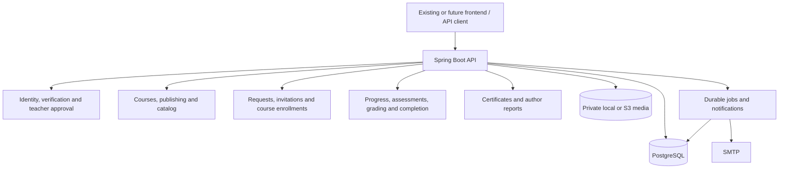

# Course-centric Learning Portal: Backend Design

Date: 23 October 2026, Asia/Dhaka. Status: proposed technical specification based on the six confirmed product decisions. Scope: backend only. Target codebase: `/Users/rizwan/Documents/Projects/LMS`. This file is a planning artifact in the SaaS workspace, not an implementation change in LMS.

Companions: [database blueprint](../../database/2026-10-23-course-centric-schema.sql), [implementation plan](../plans/2026-10-23-course-centric-backend.md).

## 1. Confirmed product decisions

1. One owner sets up one workspace per installation. No multi-workspace tenancy.
2. Exactly two account roles: `TEACHER` and `STUDENT`. Approved teachers administer workspace settings and user accounts; each course author alone controls that course's content, access, exams, grading, and reports.
3. Public registration permits choosing either role. All self-registering users verify email before course requests or teacher review.
4. Verified teacher applicants await approval. All existing active approved teachers are notified; any one approves or rejects. The first decision resolves the application. Applicants cannot approve themselves.
5. Students browse published courses and request access; the course author approves/rejects.
6. Teacher-authored email invitations preauthorize course access. Acceptance by the verified matching email enrolls the recipient without a second approval.
7. Teachers can enroll as learners using the same account; their teacher powers do not bypass course enrollment.
8. Classes, batches, class teacher assignments and class APIs are removed entirely.
9. Each exam is self-paced or scheduled, chosen by its author. Both support attempt limits and attempt duration limits.
10. Retain lesson progress, video/documents, objective and written exams, manual grading, published results, completion and certificates. No payments.

## 2. Technical decisions proposed for review

These defaults fill remaining implementation details without adding another role:

- An account has one chosen role. Teaching and learning are capabilities, not two simultaneous roles. Role switching is outside this release.
- The workspace owner is the first teacher, approved automatically only after owner email verification. `created_by` is provenance, not a permanent superuser bypass. Later approved teachers have the same workspace powers.
- Owner setup requires a one-time deployment setup secret. SMTP must be configured before public registration/setup; no silent auto-verification or demo verification bypass in production.
- Catalog summaries are public. Verified accounts of either role can request access. Drafts, lesson bodies/files, rosters, answers and grades remain private.
- A verified pending/rejected teacher can create private course drafts and learn from other courses; only approved teachers publish or administer. Rejected teachers may resubmit after 24 hours; one pending application per person.
- Approvals authorize the teacher generally, not each published course. Courses have one immutable author; no coauthors or ownership transfer in this release. Authors cannot enroll in their own course for real scores/certificates; use author preview.
- Approved teachers may suspend/reactivate user accounts. They cannot alter another course, grant a student access to another teacher's course, or read unrelated learning records. Reset actions send recovery to the user's verified email.
- No one may suspend themselves or the last active verified approved teacher. Teacher approval and account suspension share a workspace lock for this invariant.
- Teacher review notifications use in-app plus email. Course-access requests use in-app author notification; decisions and invitations use in-app/email as applicable. Rejected access requests may be retried after 24 hours; cancelled requests can be retried immediately.
- New enrollment binds to the latest published course edition. Existing enrollments stay on their edition; suspension, withdrawal, and restoration preserve scores, attempt budgets and progress. Versions are curriculum snapshots, not replacement classes.
- Invites expire in seven days, email verification in 24 hours, password reset in 30 minutes. All usable tokens are generated randomly, stored hashed and consumed atomically. Resend invalidates the previous usable token.
- One course has at most one pending invitation per normalized recipient email and one enrollment per learner. A newer invite replaces its pending predecessor. Existing active enrollment makes acceptance a harmless success.
- A scheduled required exam whose closing time has passed blocks new access grants/acceptance for that edition with `REQUIRED_EXAM_CLOSED`. The author must extend availability or publish a suitable edition. Existing students retain their original attempt deadlines.
- Archived courses disappear from discovery and reject requests/invitations/new grants; existing active learners retain materials/results. Account suspension and enrollment suspension are separate.
- Public signup changes the existing email-optional student model: all new accounts require unique verified email. CSV account creation with temporary passwords is retired; optional bulk course invitations accept verified-email onboarding instead.

## 3. Current code and reuse strategy

The actual LMS uses Java 21, Spring Boot 4.1.1, Gradle, PostgreSQL 17, JPA plus JdbcClient, Flyway, Spring Security sessions, durable database jobs and ArchUnit. Preserve these conventions and existing dependencies; no framework upgrade is needed.

Observed changes required:

| Current code | Replacement |
| --- | --- |
| `common/Role.java`, `Actor.isAdministrator()` | Two roles; server-derived verification/approval state and explicit authorization capabilities |
| `identity/service/SetupService.java` | Owner bootstrap + email verification + workspace activation |
| `identity/service/AccountService.java` | Public registration and scoped workspace account administration |
| `identity/service/AccountAuthorization.java` | `requireVerified`, `requireApprovedTeacher`, with no course-owner bypass |
| `courses/service/CourseAccess.java` and `course_teachers` | Exactly one `courses.author_id`; `requireAuthor` |
| `classrooms/**` and class lifecycle listeners | New `enrollment` module; no class objects, endpoints, FKs or synthetic classes |
| `assessments/service/ExamAssignmentService.java` | Course-edition exam schedules |
| `learning/service/ProgressService.java` | Direct course enrollment authorization |
| `grading/service/GradingService.java` | Course-author authorization instead of class/admin authorization |
| `completion/service/CompletionReconciler.java` | Enrollment → course edition → required exams |
| `certificates/service/CertificateIssueService.java` | Course/learner ownership instead of class/admin bypass |
| `reporting/service/ClassReports.java`, `ClassReportQueries.java` | Author-scoped course reports |
| `media/service/MediaAccessService.java` | Uploader/author/active learner policy; no workspace-admin content bypass |
| `operations/service/MaintenanceService.java` | Approved teacher capability |

Keep exam snapshots, scoring, autosave revision rules, decimal points, time injection, job leasing, asset streaming and certificate rendering where their behavior remains correct. Refactor integration points instead of rebuilding this infrastructure.

The backend contract changes incompatibly while the frontend remains untouched. Document replacement routes/DTOs in OpenAPI and a compatibility map. Existing UI will need a separate implementation; do not claim the assembled application works unchanged.

## 4. System and module architecture

Module layout remains `api`, `controller`, `service`, `repository`, `dto`, `entity`, `config`, `infra`, as required by LMS/AGENTS.md. Cross-module dependencies use `api` only. Controllers do not call repositories. Do not bring the old `internal` package layout back. Entities and non-record DTO classes expose fields through Lombok `@Getter` (`getX()`/`isX()`), never hand-written accessors.

Dependency direction: identity → shared infrastructure; courses → identity/media API; enrollment → identity/courses/notifications API; learning → enrollment/courses API; assessments → enrollment/courses API; grading → assessments/enrollment/courses API; completion → enrollment/learning/assessment result API; certificates → completion/enrollment/courses API; reporting → published read contracts. Media uses registered `AssetAccessPolicy` implementations, and progress/publication uses lower-module listener APIs to avoid dependency cycles. No grading or enrollment callback adds a reverse import.

## 5. Identity, setup and approval workflows

### Setup

1. `GET /setup` returns `REQUIRED`, `OWNER_VERIFICATION_PENDING`, or `ACTIVE`.
2. `POST /setup` validates the deployment secret and SMTP availability, locks workspace row, creates unverified owner `TEACHER`, and queues verification email. It does not return an authenticated privileged session.
3. Owner verifies the email; transaction marks owner approved, workspace active, and token used. Only this bootstrap transition bypasses peer approval. Log it explicitly.
4. Setup cannot create another owner. Recovery/resend remains token-bound or deployment-secret-bound; it is not a public reset of setup state.

### Public registration

`POST /auth/register` accepts username, normalized email, display name, password and `TEACHER|STUDENT`. Validate unique username/email and an active workspace. Create active but unverified account, enqueue verification. Login may establish a limited session; only verification/resend/reset/logout/me endpoints are available until verification. Verified pending teachers can browse, learn, draft and inspect their application but cannot administer or publish.

Consume verification token while locking user and token. A teacher application is created exactly once after verification. Notify the current active approved teacher set through a committed fan-out job. The actor in every command comes from the session; role/approval flags in request bodies are forbidden. Reload current account status and approval for protected requests; do not trust a role snapshot cached in a session after suspension or review changes.

### Teacher review

`PENDING → APPROVED|REJECTED`. Reviewer must be verified active approved teacher other than applicant. Lock workspace, applicant, application, then recheck reviewer. Resolve once, update authoritative `users.teacher_status`, audit, and enqueue notices. Duplicate same review by the deciding actor returns the existing result; competing/conflicting decisions return `409 APPLICATION_ALREADY_DECIDED`. Approval does not enroll the teacher anywhere. Workspace administration does not expose another author's draft or students' exam answers.

## 6. Course discovery and access

Course lifecycle: no published edition → first publication; published catalog listing; optional archive. Draft content and immutable editions stay separate. Catalog only exposes title, summary, thumbnail, author display name, edition summary and enrollment eligibility. Public responses never contain protected video IDs/URLs, lesson bodies, resource keys, question keys, learner identities or unpublished exams.

Access request lifecycle: `PENDING → APPROVED|REJECTED|CANCELLED`. Unique course/learner row is the current state; append each transition to history. Submission requires verified active account, active published course, nonauthor and no active enrollment. Repeated pending submission returns existing request. Only author approves/rejects; learner may cancel a pending request. Approval creates/restores enrollment in the same transaction, captures granting author and source, then notifies learner. Do not treat requesting as access.

Invitation flow: author submits recipient email(s), verifies course grant eligibility, creates a pending tokenized invitation and queues email. Recipient follows link, signs in/registers, verifies the matching email, then explicitly accepts. Merely opening an email link never mutates enrollment. Verification and invitation tokens are different purposes. Cross-account email mismatch yields 403, invalid/expired token generic failure; neither token is logged. At acceptance, recheck sender is still active approved course author, course is published/nonarchived and edition is eligible. Capture invitation, enrollment and any pending request resolution atomically. If author access was suspended, acceptance fails without using the token; token expiry is still enforced. Invitation revocation and acceptance are serialized.

Concurrent request approval and invite acceptance must yield one enrollment. Serialize course authorization/schedule gates, then learner/enrollment creation, use unique course/learner and transactional retry for first insert. Record one grant source as first effective grant; record other successful invitation acceptance as an audit event rather than create another enrollment. A revoked enrollment cannot be silently reactivated by a stale invitation; author revocation also revokes pending invitations for that learner/email.

## 7. Learning, exams, grades and certificates

`course_enrollments` is the learning aggregate: course, pinned edition, learner, status, grant provenance, learning-locked flag and version. Learner status is `ACTIVE|SUSPENDED|WITHDRAWN`; published history remains readable by learner after withdrawal. Teacher role does not change learner checks. Authors preview without fake enrollment or issuing certificates to themselves.

Exams belong to a course edition like its lessons: edited only in the course draft, frozen with the published edition and copied with new IDs into the next draft, so exams have no editions of their own. An exam has questions, pass mark, required flag, mode `SELF_PACED` or `SCHEDULED`, duration 1–240 minutes, attempt cap 1–10, result/feedback policy and schedule revision. Self-paced has no opens/closes, and expires per attempt. Scheduled requires opening and closing instants; attempt deadline is `min(start + duration, closes_at)`. Schedule edits affect unstarted attempts only. Required exam references are frozen when course edition publishes; optional practice exams are allowed through a new edition rather than changing an existing learner's completion policy.

Keep `IN_PROGRESS → SUBMITTED → AWAITING_GRADING|GRADED`, separate published grade revisions, server Clock, answer expectedRevision, authored question order (no shuffling), exact-set multiple select, typed written answers, auto scoring and teacher finalization. An author accessing their own course is never automatically authorized for another user's course. Feedback keys obey release policy; scheduled feedback may wait until close. Self-paced required exams default to scores/comments only so retries do not reveal keys.

Content structures and grades are pinned; progression depends on required lessons and required exam passes in that enrollment's edition. Zero pending grades satisfy no assessment requirement. Grade publication queues reconciliation. Changed failing results invalidate completion and revoke certificates; later restored eligibility requires explicit author certificate reinstatement, audited and rechecked. Certificate downloads are learner/author-only. Public verification remains optional/minimal; workspace administration grants no private certificate access.

## 8. Database architecture

The companion SQL is the complete proposed v2 baseline. No SQL has been executed. Domain IDs use UUID; timestamps use timestamptz; decimal scores stay decimal; editable aggregates have optimistic `version`. The baseline removes `user_roles`, `classes`, `class_teachers`, `course_teachers`, class-based `enrollments`, account invitation provisioning and temporary-password signup.

| Area | Tables |
| --- | --- |
| Workspace | `workspace` |
| Identity | `users`, `identity_tokens`, `teacher_applications`, `auth_rate_limits`, Spring Session tables |
| Content | `courses`, `course_versions`, `sections`, `lessons`, `lesson_resources`, `media_assets` |
| Access | `course_access_requests`, `course_access_events`, `course_invitations`, `course_enrollments` |
| Learning | `lesson_progress` |
| Assessment | `exams`, `exam_questions` (options as JSON), `exam_attempts`, `attempt_answers` |
| Grading | `grade_revisions`, `question_grades` |
| Completion | `course_completions`, `certificates` |
| Operations | `background_jobs`, `notifications`, `audit_events`, `report_exports`, `maintenance_state` |

Composite foreign keys enforce course/version, enrollment/course and exam/course consistency where possible. Service checks enforce actor approval, token purpose, question-type answers, cross-module eligibility and grading completeness. All required constraints must be covered by PostgreSQL integration tests; no H2 substitution.

State fields are authoritative, not reconstructed from notification delivery. Unique constraints handle duplicate signup, application, request, invite, enrollment, progress, attempt numbering, job deduplication and certificate creation. Index catalog lookup, author courses, pending review queues, request inboxes, learner enrollment lists, grading queues and expired attempts/jobs. GIN/full-text search is unnecessary for initial title/author catalog filtering.

## 9. Concurrency, tokens and failure recovery

Lock order for global approval/status/setup: workspace → affected users in UUID order → application. Course mutation/access: involved author/learner accounts `FOR SHARE` in UUID order → course `FOR UPDATE` → enrollment → request/invitation. Learning/exam writes: involved active accounts `FOR SHARE` in UUID order → course `FOR SHARE` → enrollment → attempt → answer/grade. Pre-read identifiers when necessary, then lock and re-read all decision state before acting. Global suspension locks workspace/user but never later locks courses; no inverse nested lock path. Start/grant on no enrollment locks the course to serialize creation. Keep locks short and dispatch SMTP/PDF only after committed jobs.

Revalidate authorization inside the transaction. An already-running authorized operation may finish before suspension obtains its exclusive user lock; once suspension commits, new protected writes fail. No immediate revocation is claimed for an already-issued short-lived S3 URL.

Tokens: 32 random bytes, URL-safe encoding, SHA-256 lookup hash, purpose separation, expiry, consumed/revoked state. Do not persist raw tokens in jobs: the existing TokenEmailHandler pattern rotates the hash and sends a fresh token on delivery. Token-email retries invalidate earlier links, and transport retries can produce duplicate emails. Expose “use the latest email” guidance. First delivery/rotation and acceptance both lock token row, so a concurrent consumed token cannot be rotated back to usable. Failed SMTP leaves durable retry state, never marks verification or grants access.

Errors use existing ApiException/RFC 9457 codes and trace IDs. Named new codes: `EMAIL_UNVERIFIED`, `TEACHER_APPROVAL_REQUIRED`, `APPLICATION_ALREADY_DECIDED`, `COURSE_AUTHOR_REQUIRED`, `ACCESS_REQUEST_COOLDOWN`, `INVITATION_EMAIL_MISMATCH`, `REQUIRED_EXAM_CLOSED`, `LEGACY_SCHEMA_UNSUPPORTED`. Public auth messages avoid unnecessary account enumeration; rate-limit registration, verification resend, login, reset, access requests and invites.

## 10. HTTP contract

Keep `/api/v1` with a documented breaking backend release. Do not maintain class aliases. DTOs are explicit; no entity serialization. Pagination uses existing PageQuery/PageResponse. Username/email login and secure session/CSRF remain.

| Method / route | Purpose / caller |
| --- | --- |
| GET, POST `/setup` | Status / owner setup with secret |
| POST `/auth/register` | Student/teacher public registration |
| POST `/auth/email/verify`, `/auth/email/resend` | Token verification / bounded resend |
| POST `/auth/login`, `/auth/logout`; GET `/auth/me`, `/auth/csrf` | Session and current capabilities |
| Existing password-reset routes | Verified-email recovery |
| GET `/workspace`; PUT `/workspace` | Public branding / approved-teacher settings |
| GET `/workspace/users`; PUT `/workspace/users/{id}/status` | Approved-teacher account administration |
| POST `/me/teacher-applications`; GET `/me/teacher-application` | Verified teacher apply/resubmit/status |
| GET `/workspace/teacher-applications`; POST `/{id}/decision` | Approved-teacher review inbox and decision |
| GET `/catalog/courses`, `/catalog/courses/{id}` | Public summaries |
| Course authoring/publishing routes under `/courses` | Verified teacher drafts; approved author publication |
| POST `/courses/{id}/access-requests`; GET `/me/access-requests` | Verified learner request/status |
| GET `/courses/{id}/access-requests`; POST `/access-requests/{id}/decision` | Course author decisions |
| POST `/access-requests/{id}/cancel` | Requesting learner |
| POST `/courses/{id}/invitations`; POST `/courses/{id}/invitations/bulk` | Author invite, maximum 100 recipients per batch |
| POST `/course-invitations/accept`; POST `/course-invitations/{id}/revoke` | Matching verified recipient / author |
| GET `/me/enrollments`; GET `/courses/{id}/enrollments` | Learner's courses / author's roster |
| PUT `/enrollments/{id}/status` | Author suspend/restore; learner withdraw endpoint separate |
| GET `/me/enrollments/{id}/content`; PUT existing lesson-progress route | Pinned edition materials and own progress |
| `/courses/{id}/exams`, `/course-exams/{id}` | Author exam schedules; learner-safe views separate |
| POST `/course-exams/{id}/attempts`; existing `/attempts/{id}` save/submit | Authorized learner exam flow |
| Existing grading routes; GET `/courses/{id}/grading` | Author-only grading and publication |
| GET `/me/results`, `/me/certificates`; certificate download/verify routes | Own results/history and optional verification |
| `/reports/courses/{id}/progress`, `/scores`, `/export` | Author-only reporting |
| Existing notifications routes | Recipient-only notices |

Capabilities response in `/auth/me`: role, emailVerified, teacherStatus, `canAdministerWorkspace`, `canPublishCourses`, `canLearn`. Capabilities reflect current state but never replace backend resource ownership checks. A verified student receives `canLearn=true`; a pending verified teacher canLearn=true but canPublishCourses=false.

## 11. Replacement and verification strategy

Use a new Flyway location `classpath:db/coursecentric` and baseline on an empty v2 database. Keep old migrations outside the active location, unchanged, for reference. Reject a nonempty legacy database before applying v2 changes. Creating a fresh database is the default development reset; dropping any existing database is an explicit operator action during implementation, not application startup. No old-data migration is promised; the user authorized a clean design. Existing backups remain legacy restore targets and are not compatible with the new application.

No `DROP DATABASE`, `flyway clean`, schema edits, dependency installation, frontend change or runtime change is part of this planning task. Implementation removes legacy Java references/tests and updates backend OpenAPI, demo fixtures and operational runbooks. Produce a checklist for frontend follow-up without editing it.

Acceptance: owner activation; verified signup both roles; two concurrent reviewers; pending teacher denied workspace/publishing; author-only boundaries despite teacher workspace privileges; direct request/invite grants; mismatch/revocation/duplicate races; teacher-as-learner; no classes in schema/API; both exam modes; no key leakage; manual grading; deterministic completion/certificates; durable notices; restart/recovery; fresh-schema install and legacy-schema refusal. Use existing `MutableClock`, PostgreSQL fixtures, ArchUnit and Gradle commands. Tests in the implementation plan are future work; none were run against these proposed changes.
